# ThoughtFull: session booking with reminders

A member finds a professional, sees their free slots for the next 4 weeks in the member's own timezone, and books a 50-minute session. Both people get in-app reminders 24 hours and 1 hour before it starts.
Double-booking, the 24-hour cancel rule and exactly-once reminders are enforced in the database and the backend, and tested against a real Postgres.

## Prerequisites
- Node.js 24 (npm comes with it). Check with `node -v`.
- Docker with Docker Compose v2. It runs PostgreSQL, and the whole app for the quick start.

## Quick start
```bash
docker compose up
```
The first run builds the image, so give it a few minutes. When it settles, open **http://localhost:5173**.

Compose starts six things: `db` (Postgres 16), `migrate` (creates the tables and the demo accounts, then exits), `api` (port 3000), `worker` (delivers reminders), `mailpit` (a local test inbox for reminder emails, http://localhost:8025) and `web` (port 5173). Press Ctrl+C to stop; `docker compose down` removes the containers (add `-v` to also delete the data).

The seed (`apps/api/src/seed.ts`) creates these fictional accounts. All use the password `demo-password-123` (`SEED_PASSWORD` in `.env.example`).

| Role | Email | Name | Timezone |
|---|---|---|---|
| member | `lina.tan@example.test` | Lina Tan | Asia/Singapore |
| member | `sam.carter@example.test` | Sam Carter | Europe/London |
| professional | `mira.okafor@example.test` | Dr. Mira Okafor | Europe/London |
| professional | `tomas.reyes@example.test` | Dr. Tomas Reyes | America/New_York |
| professional | `aiko.tanaka@example.test` | Aiko Tanaka, counsellor | Asia/Singapore |

The `web` container runs the Vite dev server. That is fine for a demo, not for production (see `DECISIONS.md`).

## Tests
```bash
npm install
npm test
```
`npm test` starts its own throwaway Postgres in Docker (`db-test`, kept in memory, port 54329), builds the schema from the real migrations, and runs all tests with Vitest. Nothing in your development database is touched. What it covers:
- **Slots and daylight saving:** slot grid, 28-day window, working hours in the professional's zone, clock changes in London and New York (`packages/domain/src/slots.test.ts`).
- **The 24-hour rule:** exactly 24 h is allowed, 1 ms later is blocked, counted in real hours across a clock change (`packages/domain/src/rules.test.ts`, `apps/api/test/cancel-reschedule.int.test.ts`).
- **Double-booking races:** ten members booking one slot at the same moment, one member booking two professionals at once, racing reschedules and cancels (`apps/api/test/booking.int.test.ts`, `cancel-reschedule.int.test.ts`).
- **Reminders exactly once:** the schedule, a crash before commit followed by a restart, two workers at once, no delivery for cancelled sessions (`packages/domain/src/reminders.test.ts`, `apps/api/test/reminders.int.test.ts`).
- **Access control:** who can see or change which session, 401/403/404 answers, login limits (`apps/api/test/*.int.test.ts`).

Also available: `npm run lint` and `npm run typecheck`.

## Local development
Use this to run the code on your machine with only the database in Docker.
```bash
cp .env.example .env          # PowerShell: Copy-Item .env.example .env
npm install
docker compose up -d db mailpit   # Postgres on localhost:54320, test inbox on http://localhost:8025
npm run db:migrate            # create the tables
npm run seed                  # add the demo accounts, prints their logins
npm run dev                   # API + reminder worker + web, one terminal
```
`npm run dev` (`scripts/dev.js`) starts the API on port 3000, the worker, and Vite on http://localhost:5173, and stops all three on Ctrl+C. The API port is `API_PORT`, not `PORT`, so another tool's `PORT` cannot hijack it.

If you already ran the quick start, stop it first (`docker compose down`): both use ports 3000 and 5173.

## Architecture
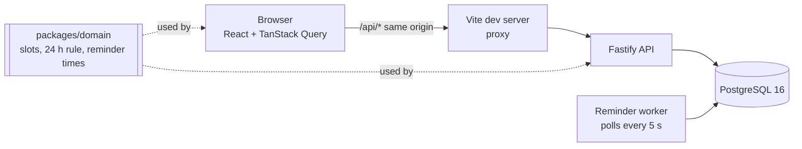
- The browser only talks to the Vite server, which forwards `/api` to the API, so the login cookie is same-origin and no CORS is needed.
- The API identifies the caller from the session cookie on every request, and Postgres has the final say on conflicts: two exclusion constraints stop double-booking.
- The reminders table is the queue. A booking writes its reminders in the same transaction; the worker, a separate process, turns due reminders into notifications.
- `packages/domain` holds the pure rules (no database, no HTTP) built on Luxon for IANA timezones, so the API and the web app share one definition of a slot, the 24-hour rule and reminder times.

A step-by-step walkthrough of a booking and of a reminder delivery is in [docs/architecture.md](docs/architecture.md). The reasoning behind each choice is in [DECISIONS.md](DECISIONS.md).

## Project layout
```
apps/api/            Fastify API, worker, SQL migrations, seed
  migrations/          0004_sessions_guards.sql holds the no-overlap constraints
  src/sessions/        book, cancel, reschedule
  src/reminders/       deliver.ts: the worker's delivery transaction
  src/worker.ts        the reminder worker process
  test/                integration tests (real Postgres)
apps/web/            React + Vite screens
packages/domain/     pure rules: slots, 24 h rule, reminder times (Luxon)
scripts/dev.js       runs api + worker + web together
docker-compose.yml   db, migrate, api, worker, web (and db-test for the tests)
DECISIONS.md         decisions, trade-offs, limitations, production notes
AI_USAGE.md          how I used AI tools, with examples I corrected
```

## Try it
This walks through the cross-timezone case.
1. Open http://localhost:5173 and log in as **Lina Tan** (`lina.tan@example.test`, Singapore).
2. Go to **Find a professional**. Each name shows the professional's zone. Open **Dr. Mira Okafor** (works in Europe/London).
3. Slots are shown in Lina's zone ("Times shown in Asia/Singapore"). Mira works 09:00 to 17:00 London time with a lunch break; in winter that is 17:00 to 01:00 in Singapore, so her 16:00 London slot appears on the next day at 00:00. Pick a slot more than a day ahead (so that step 6 is allowed), check the confirmation screen, and click **Book session**.
4. Open **My sessions**. The session is listed under Upcoming, in Singapore time.
5. In a private window, log in as **Dr. Mira Okafor**. **My schedule** shows the same session in London time, with Lina's name. Same moment, two clocks.
6. As Lina, click **Reschedule** on the session and pick another time. The old session disappears from Upcoming and the new one replaces it; Mira gets a "moved" notification.
7. As Lina, open the **Notifications** page (also in the header). Book a session less than 24 hours ahead and the **Cancel** and **Reschedule** buttons are disabled with "Changes are possible up to 24 hours before the start".
8. As Mira, cancel a session (she can at any time). Lina's notifications list shows that it was cancelled, and the session appears under Past as "Cancelled by the professional".

As **Dr. Mira Okafor**, **My hours** also has **Time off**: block a day (she already has a training day about three weeks ahead) and it disappears from members' calendars; if sessions are still booked that day, a warning says so, and the dashboard lists upcoming days off. **Settings** has the **booking notice** (the demo professionals ask for 2 hours): members see "Books at least 2 hours ahead" and cannot book a time that starts sooner.

Email reminders (on by default, switchable in **Settings**) go only to the local Mailpit inbox at http://localhost:8025, never to real addresses; they say only that a session is coming up and when. A sample is in [docs/screenshots/desktop-email.png](docs/screenshots/desktop-email.png).

Reminders appear in the Notifications list when they are due: the 24-hour one 24 hours before the start, the 1-hour one an hour before. A reminder whose time had already passed at booking is not created. The worker checks every 5 seconds and the page refreshes every 30, so allow up to about 35 seconds. To see one without waiting a day, book the soonest free slot: if it starts in 90 minutes, its 1-hour reminder arrives after 30 minutes. A slot that starts in under an hour gets no reminders at all.

## Screenshots and responsive design
These are taken from the running app with the demo accounts, on a 1440 px desktop window and a 390 px phone.

**Log in**

| Desktop | Phone |
| --- | --- |
| 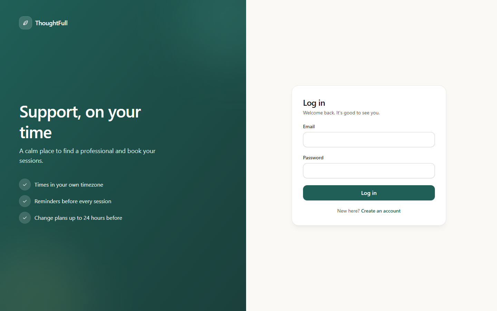 | 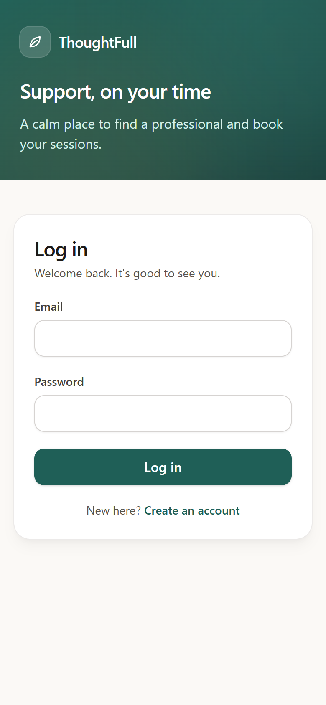 |

**Member home (Lina, Singapore time)**

| Desktop | Phone |
| --- | --- |
| 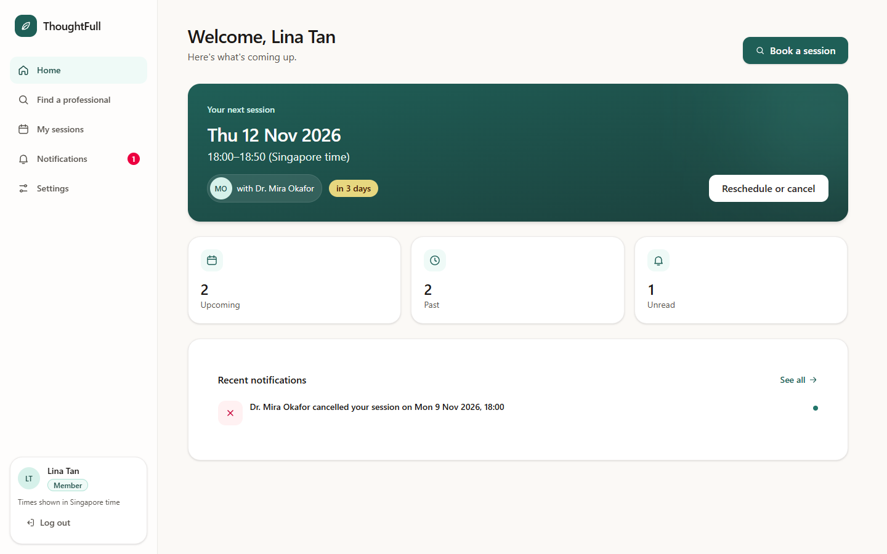 | 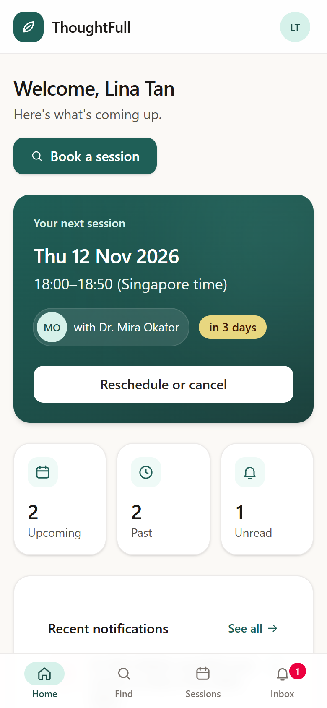 |

**Booking page with a time chosen (Dr. Mira Okafor)**

| Desktop | Phone |
| --- | --- |
| 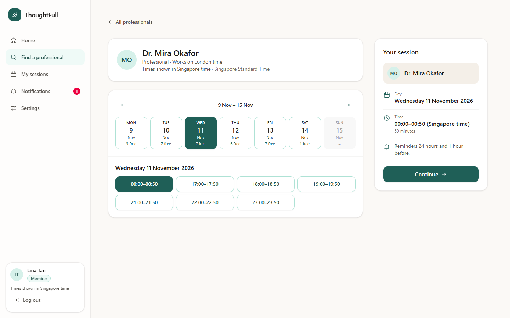 | 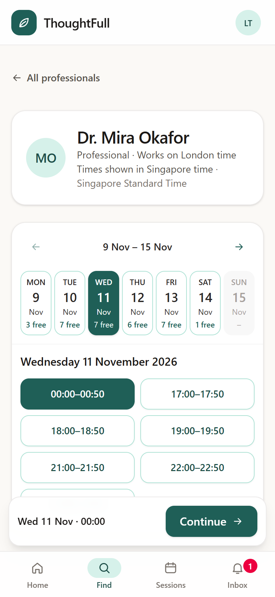 |

**My sessions**

| Desktop | Phone |
| --- | --- |
| 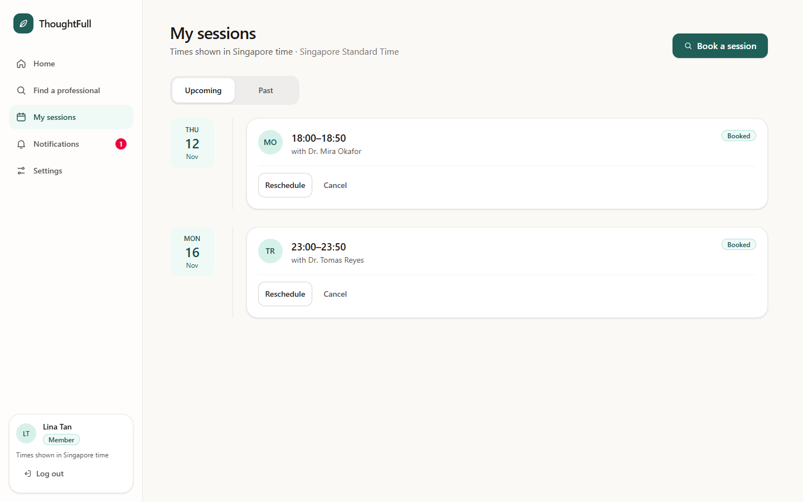 | 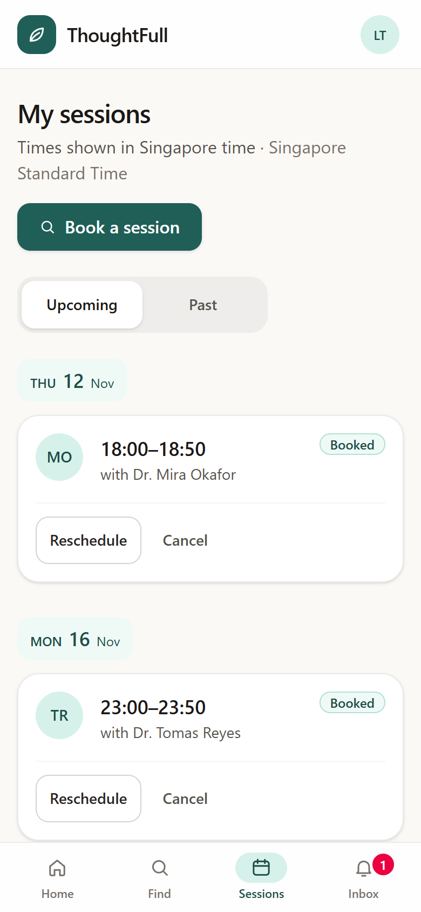 |

**Working hours, Monday open (Dr. Mira Okafor, London time)**

| Desktop | Phone |
| --- | --- |
| 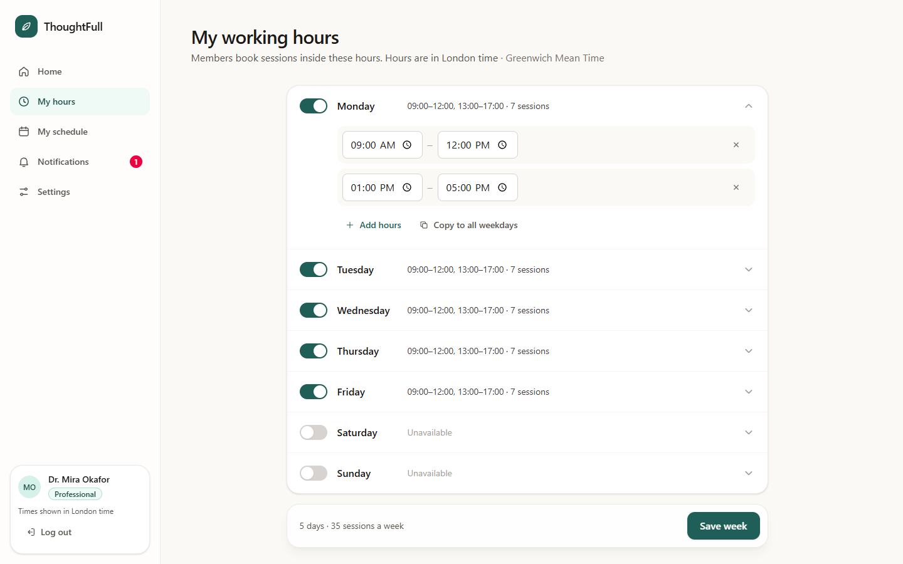 | 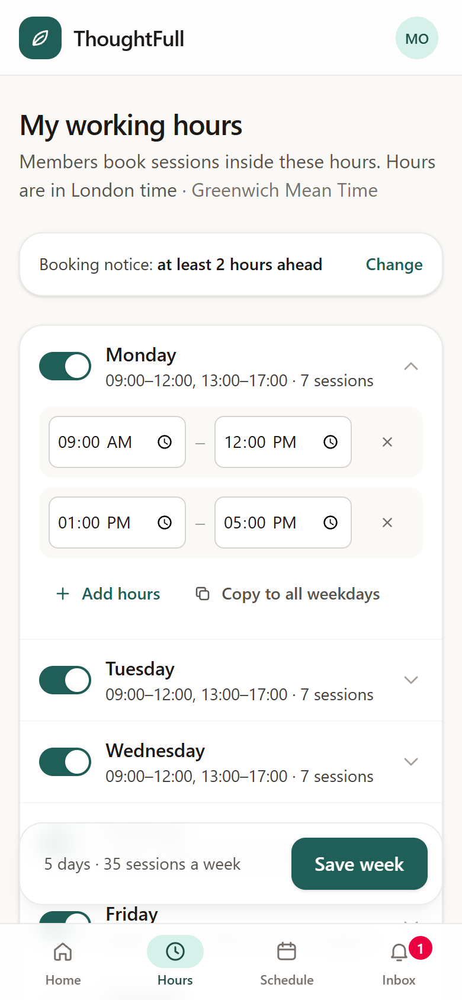 |

**Professional home with upcoming time off (Dr. Mira Okafor)**

| Desktop | Phone |
| --- | --- |
| 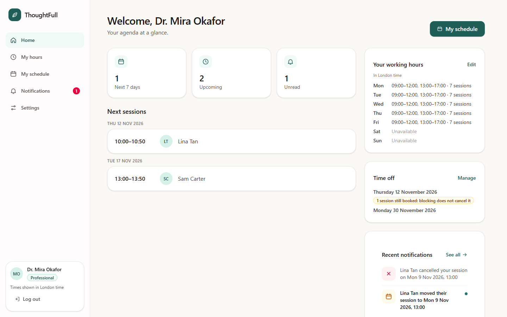 | 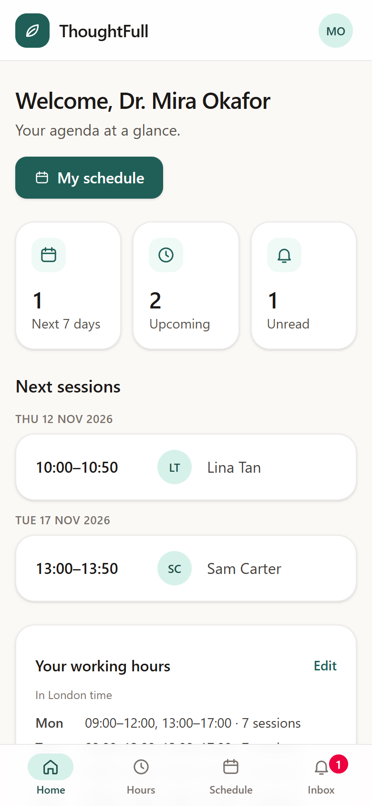 |

**Time off, with a warning for a day that still has a booking**

| Desktop | Phone |
| --- | --- |
| 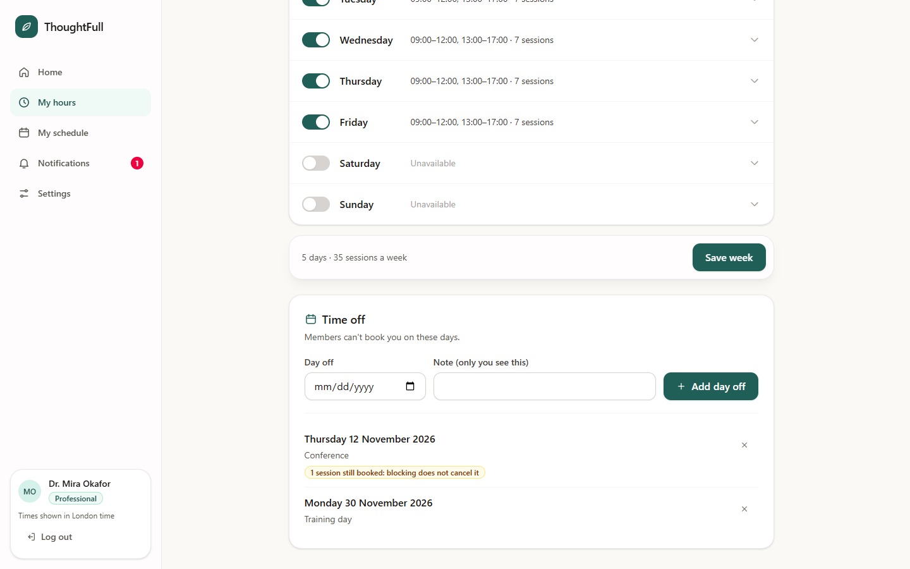 | 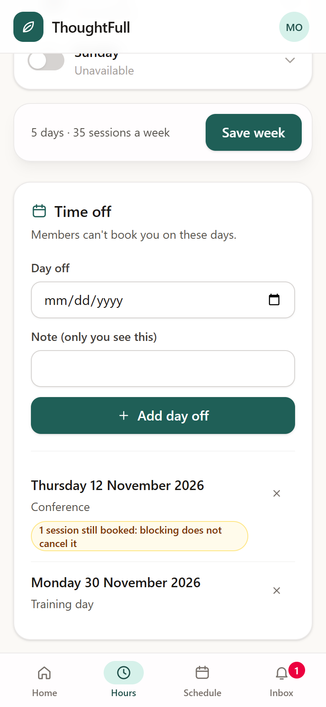 |

**Settings: email reminders and the booking notice**

| Desktop | Phone |
| --- | --- |
| 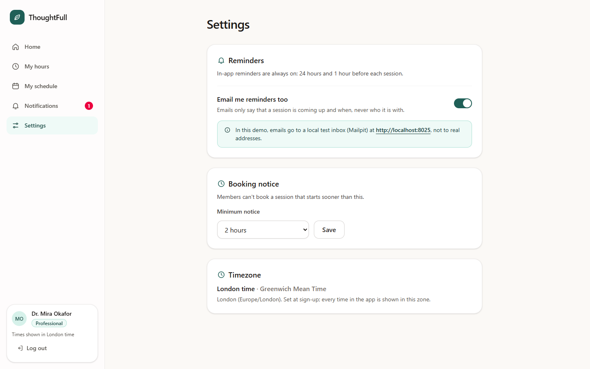 | 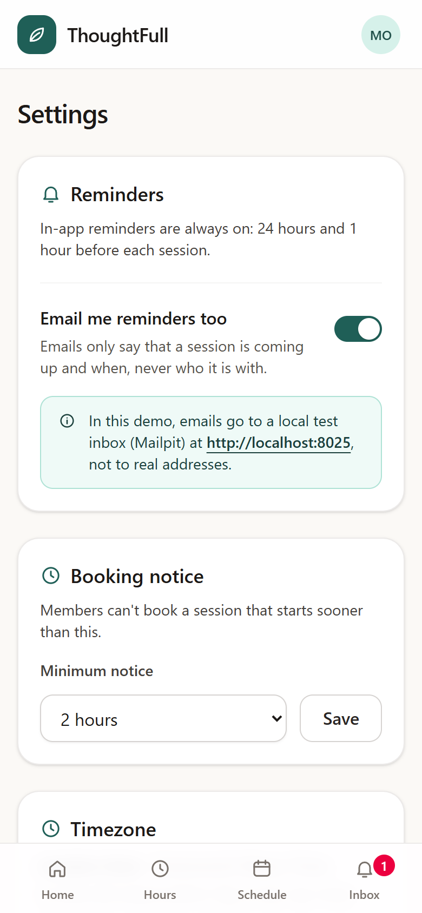 |

**Reminder email (local Mailpit inbox)**

| Desktop | Phone |
| --- | --- |
| 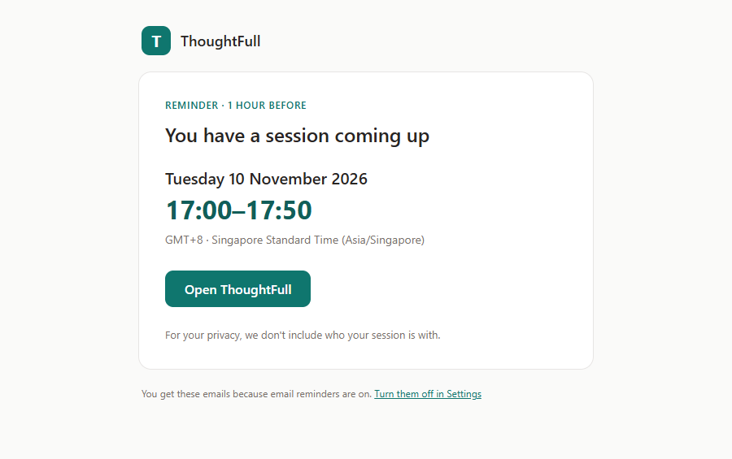 | 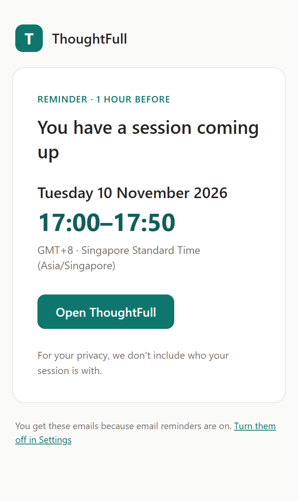 |

How the layout adapts:
- The sidebar on desktop becomes a bottom tab bar on a phone, so the main actions stay within thumb reach.
- The booking summary panel beside the calendar becomes a sticky bar at the bottom with the chosen time and the Continue button.
- The week calendar keeps all 7 days on a 375 px phone; the day buttons just get narrower.
- In the working-hours accordion each day's summary moves under its name and the start and end inputs shrink to share one row, so a day still fits on a 375 px screen.
- I checked that nothing scrolls sideways at 375 px.
- The time-off form stacks into one column on a phone, and the "still booked" warning wraps inside its badge.
- Soft motion (fades) is switched off for people who ask their device for reduced motion.
- Times are always shown in the viewer's own timezone, and the zone is named on the page.

## Why there is no hosted demo
A deployed demo link is optional in the brief, and I chose not to host one, even though the app could be hosted. The blockers are in how the pieces fit a typical host, not in the code:
- **The reminder worker must run all the time.** It checks for due reminders every 5 seconds. Serverless platforms such as Vercel run code only per request, and their scheduled jobs run at most once a minute (once a day on free plans), so reminders would arrive late or not at all.
- **The login cookie needs one address.** The browser and the API share one origin through the Vite proxy, which keeps the session cookie `SameSite=Lax` and lets the API refuse writes from other sites (it compares `Origin` with `Host`). Splitting the website and the API across two hosts would need a proxy rewrite on the host and a change to that check, which is extra risk for a demo.
- **Email reminders go to a local test inbox.** Mailpit catches every email on the machine. Online it would either have to be exposed (a public inbox, even of fictional data, is a bad habit for a health product) or replaced by a real email provider, which the brief puts out of scope.
- **Cost and accounts.** Postgres, the API, the worker and Mailpit as always-on services cost a few dollars a month and need a hosting account.

How I would host it: one Docker-friendly platform (Railway, Render or Fly.io) running the same images as `docker-compose.yml` — managed Postgres, the API serving the built web app on one address, the worker as a background service, and a real email provider behind the existing outbox. Until then, `docker compose up` gives the full app locally in one command.

## More
- [DECISIONS.md](DECISIONS.md): decisions and trade-offs, how double-booking is prevented, how reminders are delivered exactly once, timezones and daylight saving, assumptions, limitations, what I would change for a healthcare product.
- [AI_USAGE.md](AI_USAGE.md): which AI tools I used, and where I corrected them.
- [docs/architecture.md](docs/architecture.md): diagram and request walkthroughs.
