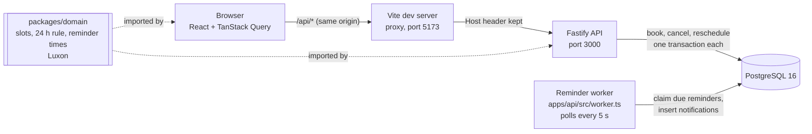

# Architecture

## Components

- **Browser to API.** The browser only knows the Vite server, which forwards `/api` to the API (`apps/web/vite.config.ts`). The login cookie is therefore same-origin. `changeOrigin: false` keeps the browser's `Host` header, which the API's origin check compares with `Origin` (`apps/api/src/app.ts`).
- **API.** Fastify routes in `apps/api/src`: `auth/`, `availability/`, `professionals/`, `sessions/`, `notifications/`. Each request is tied to a user by the session cookie (`onRequest` hook in `app.ts`), never by an id the client sends.
- **Database.** PostgreSQL 16 holds users, login sessions, working hours, sessions, reminders and notifications. The schema is in `apps/api/src/db/schema.ts`; migrations are in `apps/api/migrations/`. The no-double-booking rules are constraints, not application code.
- **Worker.** A separate Node process that delivers reminders. It shares the database with the API and nothing else, so there is nothing to keep in sync.
- **Domain package.** Pure functions with no I/O: `generateSlots`, `canMemberChange`, `reminderSchedule`, `groupSlotsByLocalDay`. The API uses them to decide what is bookable; the web app uses them to group slots by the viewer's local day.

## Walkthrough: booking a session
Member Lina (Asia/Singapore) books Dr. Mira Okafor (Europe/London). `POST /api/sessions` with `{ professionalId, startsAt }`, in `apps/api/src/sessions/routes.ts`.

1. **Who is asking.** The `onRequest` hook turns the cookie into `req.user` (`findSessionUser` in `apps/api/src/auth/sessions.ts`). `requireRole("member")` rejects anyone else with 401 or 403. The body is parsed by zod, which drops any field not listed, so a client-sent member id never reaches the code.
2. **Is it a real slot?** `findProfessional` loads the professional (404 for anything that is not one). `findSlot` calls `generateSlots` (`packages/domain/src/slots.ts`) with Mira's working hours and her zone and looks for the exact start. This rules out the past, off-grid times, times outside her hours, and anything beyond now + 28 days. It does not look at other bookings (D23).
3. **Take turns.** A transaction starts. `lockPeople` locks both users' rows in id order (`apps/api/src/sessions/writes.ts`), so racing bookings queue instead of deadlocking (D30).
4. **Insert.** `insertSession` inserts the session with `ends_at = starts_at + 50 min`. Here Postgres enforces the rules: `sessions_no_professional_overlap` and `sessions_no_member_overlap` (exclusion constraints, `0004_sessions_guards.sql`) and the trigger that rejects a start in the past. If the loser of a race gets here, Postgres raises 23P01 and `apps/api/src/errors.ts` turns it into 409 `SLOT_TAKEN` or `MEMBER_OVERLAP`.
5. **Schedule reminders in the same transaction.** `reminderSchedule` (`packages/domain/src/reminders.ts`) returns the 24 h and 1 h reminders for both people, leaving out any whose time has already passed. They are inserted into `reminders` before the commit. A booking and its reminders exist together or not at all.
6. **Answer.** 201 with the session and the professional's public profile (id, name, timezone). Times are ISO-8601 UTC.
7. **Display.** The browser formats them in Lina's account timezone (`apps/web/src/format.ts`), so Mira's 09:00 London slot reads 17:00 in winter.

Cancel and reschedule follow the same pattern. They lock the session `FOR NO KEY UPDATE`, check the 24-hour rule on the locked row (`assertChangeable`), and mark the pending reminders cancelled. A reschedule cancels the old session and inserts the new one, with new reminders, in one transaction, so a failure rolls back both.

## Walkthrough: delivering a reminder
`apps/api/src/worker.ts` loops every 5 seconds and calls `deliverDueReminders` (`apps/api/src/reminders/deliver.ts`).

1. **Claim.** In one transaction, select reminders that are not delivered, not cancelled, due (`due_at <= now`), and whose session is still booked and has not started. `FOR UPDATE OF reminders SKIP LOCKED` locks those rows; another worker running at the same time skips them. At most 50 per batch.
2. **Notify.** Insert one `notifications` row per reminder, with the reminder's id in `reminder_id`. That column is `UNIQUE`, a second guard against a duplicate.
3. **Mark.** Set `delivered_at` on the reminders.
4. **Commit.** Steps 2 and 3 become visible together. If the process dies before this point, Postgres rolls both back and the reminder is picked up on the next run, by this worker after a restart or by another one. After the commit it is never selected again. The loop repeats until a batch comes back empty.
5. **Show.** The web app polls `GET /api/notifications` every 30 seconds (`apps/web/src/Notifications.tsx`). Only the caller's own notifications are returned, with the other person's name and no email.

The two delivery tests that prove this are in `apps/api/test/reminders.int.test.ts`: a crash between the insert and the commit followed by a new connection pool, and two workers racing over twenty due reminders.
